<h1 align="center">Vinícius Freitas</h1>

  <strong>Desenvolvedor Front-end Pleno · React Native, React e TypeScript</strong> 
  Formado em Engenharia de Software pela UTFPR

  

  Desenvolvo apps iOS e Android com React Native e Expo e interfaces web com React e Next.js, 
  usando TypeScript. No backend, trabalho com Node.js e Firebase.

  Desde 2022, são <strong>+2000 commits</strong>, a maior parte em repositórios privados no GitLab, 
  que não aparecem nas estatísticas públicas do GitHub.

<h3 align="center">Habilidades</h3>

  <table>
    <tr>
      <td><b>Mobile</b></td>
      <td>
        
        
        
        
        
        
        
        
        
        
      </td>
    </tr>
    <tr>
      <td><b>Web</b></td>
      <td>
        
        
        
        
        
        
        
      </td>
    </tr>
    <tr>
      <td><b>Estado e dados</b></td>
      <td>
        
        
        
        
        
        
      </td>
    </tr>
    <tr>
      <td><b>Qualidade e CI/CD</b></td>
      <td>
        
        
        
        
        
        
      </td>
    </tr>
    <tr>
      <td><b>Backend</b></td>
      <td>
        
        
        
        
      </td>
    </tr>
    <tr>
      <td><b>Linguagens</b></td>
      <td>
        
        
        
        
      </td>
    </tr>
  </table>

 

  

